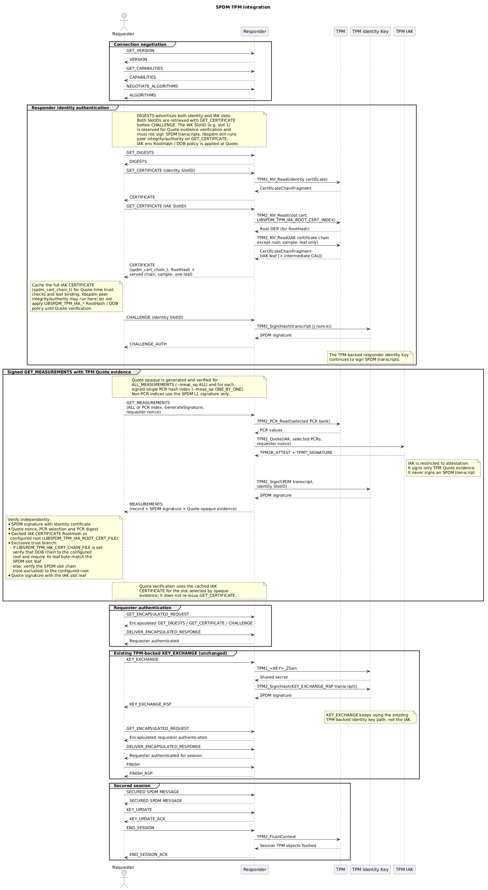

# TPM Support

## Overview

This implementation enables a Trusted Platform Module (TPM) to serve as the **Root of Trust** for SPDM flows by:
- Storing device private keys securely
- Performing cryptographic signing operations
- Providing certificates and measurement data
- Attesting the PCR measurements with a TPM2_Quote signed by a restricted IAK

Testing is performed using a **software TPM (`swtpm`)**, enabling full validation without requiring physical TPM hardware.

---

## Supported SPDM Flows

- GET_CERTIFICATE  
- CHALLENGE_AUTH  
- GET_MEASUREMENTS  
- KEY_EXCHANGE  



---

## Implementation

TPM-backed functionality is implemented in `libspdm` under:

```
os_stub/spdm_device_secret_lib_tpm/
```

### Components

- `read_pub_cert.c` – Retrieves certificates from TPM NV storage  
- `chal.c` – Performs TPM-based challenge signing  
- `meas.c` – Provides PCR 0..15 measurements and, for signed requests, a TPM2_Quote of them in
  MEASUREMENTS.OpaqueData
- `sign.c` – Performs signing using TPM-resident keys  

---

Optional:

```
# For Debian/Ubuntu
export OPENSSL_MODULES=/usr/lib/$(uname -m)-linux-gnu/ssl-modules

# For RHL/Fedora
export OPENSSL_MODULES=/usr/lib64/ossl-modules

# For ArchLinux
export OPENSSL_MODULES=/usr/lib/ossl-modules
```

---

## TPM Setup

**Do not run this script with root permissions**

```
export TPM2TOOLS_TCTI=swtpm:port=2321
export TPM2OPENSSL_TCTI=swtpm:port=2321
cd build/bin
../../script/setup-tpm.sh --cleanup --start-swtpm
```

The script retains the existing Requester and Responder parent/child key layouts,
adds a restricted IAK, and uses `script/tpm-devid.sh` for enrollment and certificate
binding checks. Options:

- `--start-swtpm` starts a swtpm, `--wait-swtpm` waits for it.
- `--cleanup` removes previously provisioned objects first.
- `--device-serial=<hex>` sets the IDevID / IAK Subject serialNumber (random by default).
- `--key-algorithm=` / `--hash-algorithm=` select the key template.

If reusing a build directory configured with the former `0x81020000` identity
key, clear the cached responder handle and certificate-chain overrides from the
repository root before rebuilding:

```sh
cmake -S . -B build -U LIBSPDM_TPM_RESPONDER_HANDLES -U LIBSPDM_TPM_RESPONDER_CERTCHAINS
```

With `--key-algorithm=ecc`, hash 256/384 selects a P-256/P-384 responder
IDevID and IAK. The requester key remains P-256, so use `--req_asym ECDSA_P256`.
The RSA profile uses `--key-algorithm=rsa --hash-algorithm=256`: the identity
key supports RSASSA/RSAPSS, and the IAK uses RSA-PSS with SHA-256.

### TCTI Configuration

```
export TPM2TOOLS_TCTI="swtpm:port=2321"
export TPM2OPENSSL_TCTI="swtpm:port=2321"
```

---

## TPM Provisioned Objects

### Persistent Handles

| Name     | Handle     |
|----------|-----------|
| ROOT_CTX | 0x81000000 |
| ROOT_KEY | 0x81000001 |
| REQU_CTX | 0x81000010 |
| REQU_KEY | 0x81000011 |
| RESP_CTX | 0x81000020 |
| RESP_KEY | 0x81000021 |
| IAK_KEY | 0x81020001 |

---

### NV Indices

| Name              | Index       |
|-------------------|------------|
| ROOT_CERT         | 0x01500000 |
| REQU_CERT         | 0x01500010 |
| REQU_CERT_CHAIN   | 0x01500011 |
| RESP_CERT         | 0x01500020 |
| RESP_CERT_CHAIN   | 0x01500021 |
| IAK_CERT_CHAIN    | 0x01C90100 |

The Responder retains its parent `RESP_CTX` and child signing key `RESP_KEY`
(`0x81000021`, chain `0x01500021`). The child key has DevID signing attributes and
policy, and its identity certificate is bound to the IAK during enrollment. The
IAK (`0x81020001`, chain `0x01C90100`) is a restricted key that only signs TPM2_Quote evidence; its
chain is served on Responder slot 5 (`LIBSPDM_TPM_IAK_SLOT_ID`), which is never used for SPDM
signing. Both certificates carry the same TCG `hardwareModuleName`, which identifies the TPM.

---

## Running the Responder and the Requester

TPM builds support both ordinary and multi-key connections. SPDM 1.3+ negotiates
multi-key by default when both peers support it. The TPM backend assigns contiguous
KeyPairIDs to distinct configured handles and reads their algorithms from the actual
public keys. With the default provisioning, slots 0/1/4 share identity KeyPairID 1;
slot 5 uses IAK KeyPairID 2 and advertises only `StandardsKeyUse` with `GenericCert`.
The IAK ID and unknown IDs are rejected by the SPDM signing path.

Identity-key certificate associations can change only within their configured
signing slots. IAK associations and usages are fixed, and SPDM cannot generate or
erase the provisioned keys. The Requester checks key-pair capabilities before its
CHANGE/ERASE sample and skips keys that do not support both operations.

The Quote is carried in OpaqueDataFmt1. `--other_param OPAQUE_FMT_1` explicitly selects
an ordinary connection; SPDM 1.3+ can use `OPAQUE_FMT_1,MULTI_KEY_CONN`. Use one
TPM per side, for example two swtpm instances with copies of the provisioned state:

```
TPM2TOOLS_TCTI=swtpm:port=2321 TPM2OPENSSL_TCTI=swtpm:port=2321 \
  ./spdm_responder_emu --ver 1.2 --hash SHA_256 --meas_hash SHA_256 --asym ECDSA_P256 \
  --req_asym ECDSA_P256 --other_param OPAQUE_FMT_1

TPM2TOOLS_TCTI=swtpm:port=2331 TPM2OPENSSL_TCTI=swtpm:port=2331 \
  ./spdm_requester_emu --ver 1.2 --hash SHA_256 --meas_hash SHA_256 --asym ECDSA_P256 \
  --req_asym ECDSA_P256 --other_param OPAQUE_FMT_1 --exe_conn DIGEST,CERT,CHAL,MEAS
```

Run `tpm2_shutdown` before stopping a swtpm; otherwise the next start can hit the TPM lockout.

---

## Validation Procedure

### GET_CERTIFICATE
Retrieves certificates from TPM NV storage

### CHALLENGE_AUTH
TPM signs challenge using private key

### GET_MEASUREMENTS
Returns PCR 0..15 as measurement blocks (PCR 0..14 at index 1..15, PCR 15 at index 0x12). For a
signed request the Responder reads the reported PCRs in one snapshot, quotes the same PCRs with the
IAK (qualifying data = requester nonce), checks that the Quote matches the snapshot, and returns it
in MEASUREMENTS.OpaqueData. MEASUREMENTS.Signature is still made with the IDevID.

For every signed MEASUREMENTS with a Quote, the Requester (`tpm_quote_verify.c`, built with
`LIBSPDM_TPM_SUPPORT`) checks, with the libspdm TPM API:

- the Quote names the IAK slot, not the slot that signed MEASUREMENTS;
- the IAK certificate asserts `tcg-cap-verifiedTPMRestricted` and has the same `hardwareModuleName`
  as the signing identity (the CA verified this at enrollment);
- the Quote signature (IAK), its nonce, and that it attests exactly the PCR blocks of the record.

When the peer advertises the IAK slot, a signed PCR response without a Quote is
rejected. Unsigned measurements, non-PCR blocks and peers that do not advertise
the IAK slot may omit Quote evidence. The attester sample applies the same
verification to both its ALL request and its one-by-one fallback.

It logs `TPM Quote verification passed (IAK slot 5)`. Only PCR values are verified; the measurement
extension log is not replayed.

### KEY_EXCHANGE
TPM signs key exchange messages

---

## Security Considerations

- Private keys never leave TPM  
- All signing operations are TPM-backed  
- Certificates stored in TPM NV memory  
- The IAK is a restricted TPM key: it signs only TPM-generated attestation data, so it cannot be
  used to sign SPDM transcripts

---

## Offline Tests

The existing `libspdm/unit_test/test_spdm_tpm` suite covers PCR collection,
Quote encoding, nonce/PCR verification, TPM key metadata and RSA-PSS IAKs.
It also checks TPM-backed RSASSA/RSAPSS transcript signatures. Build the
`test_spdm_tpm` target in a standalone TPM-enabled libspdm build, then run:

```sh
env -u TPM2TOOLS_TCTI -u TPM2OPENSSL_TCTI <libspdm-build>/bin/test_spdm_tpm
```

The existing `libspdm/unit_test/test_spdm_tpm/run_tpm_test.sh` helper accepts that
binary path and provisions a private swtpm for live tests, including a restricted
IAK. It requires no Python. Emulator integration continues through the original
`spdm_responder_emu` and `spdm_requester_emu` commands in TPM CI.


---
